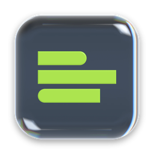

  

<h1 align="center">postd for Mac</h1>

  Just postd. Less stress. More posts. Now as an app on your Mac. 
  <a href="https://postd.ai/en/download"><b>Download at postd.ai</b></a> · <a href="https://postd.ai">postd.ai</a>

## What it is

postd is the posting tool with carousel editor, moodboard and content calendar. Instagram first, more networks follow. The desktop app is the same postd you know from the browser, in its own window, one click away in your Dock.

- **Same account, same brands, same projects.** Sign in and keep working where you left off.
- **Updates itself.** New versions download in the background. You restart when it suits you.
- **Signed and notarized by Apple.** Opens like any other Mac app, no security workarounds.
- **Apple Silicon and Intel.** One download for every Mac.

## Get it

Public beta from **11 November 2026, 11:11 (Berlin)**.

Download the app at **[postd.ai/en/download](https://postd.ai/en/download)**. Open the DMG, drag postd into Applications, done.

## About this repository

This repository only hosts the finished app files for each release. The source code of postd is not public. Questions, feedback or bugs: write to us at [postd.ai](https://postd.ai).

---

Deutsch

**postd für den Mac.** Just postd. Weniger Stress, mehr Posts. Posting-Tool mit Carousel-Editor, Moodboard und Content-Kalender, jetzt als eigene App auf deinem Mac. Konto, Brands und Projekte bleiben dieselben wie im Browser. Die App aktualisiert sich selbst, ist von Apple signiert und notarisiert und läuft auf Apple Silicon und Intel.

Public Beta ab **11.11.2026, 11:11 Uhr**. Download unter **[postd.ai/download](https://postd.ai/download)**.

Dieses Repository enthält nur die fertigen App-Dateien der Releases, keinen Quellcode.

